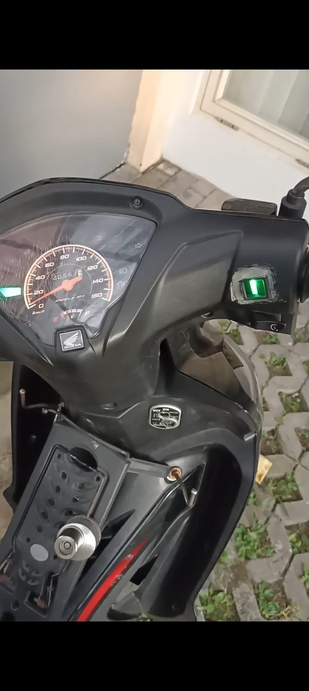
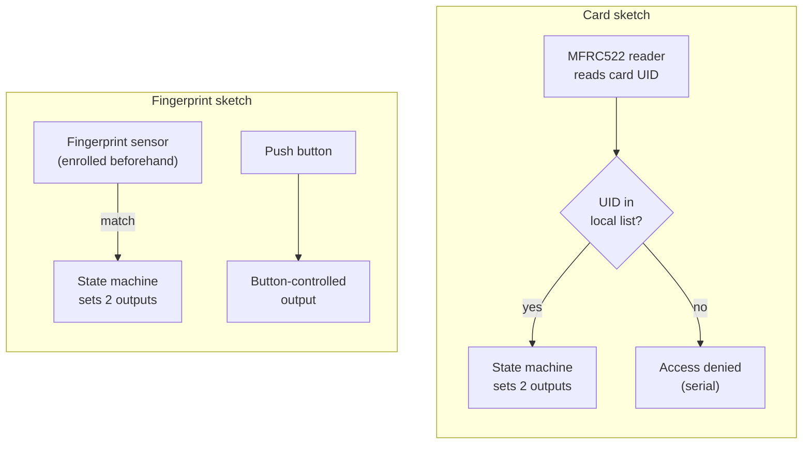

# Project Motor

Two Arduino sketches that gate digital outputs behind a user check: one uses an **RFID card reader (MFRC522)**, the other an **optical fingerprint sensor**. Both implement the same small idea: a first successful check turns one output on, a second check activates another, and after a timeout a further check turns everything off.

These are historical hardware prototypes. They are **not** hardened access-control or safety systems, and they should not be used to guard anything that matters.

## Project documentation



*Historical photo of the motorcycle fingerprint prototype, which corresponds to the fingerprint experiment only. It does not show the RFID experiment combined with it, or a secure installation.*

- [Full gallery and provenance](docs/PROJECT_DOCUMENTATION.md) (the original video link returned HTTP 404 on 22 October 2026 and is listed there)

## How it works

The two sketches are independent experiments for different boards; they are not wired together. Both use the same idea: successive successful checks step through a small state machine that drives output pins.



*Prototype logic only: not an access-control or safety design.*

## Sketches

### `Card/` — RFID card version

- Reader: MFRC522 over SPI with `SS` on pin 10 and `RST` on pin 9 (hardware SPI pins for your board).
- Outputs: pin 2 and pin 3. The code does not say what is wired to them; the project name suggests a motor stage, but no driver hardware is described.
- Serial monitor: 9600 baud. Each scanned UID is printed as `UID tag : XX XX XX XX`, followed by `Authorized access` or `Access denied`.
- Behaviour:
  1. First accepted card: pin 2 goes HIGH (then a 4 s blocking delay).
  2. Second accepted card: pin 3 goes HIGH.
  3. About 6 s after the first tap, the next accepted card sets both pins LOW and resets the state.
- Two accepted UIDs are supported (one 4-byte and one 7-byte format are accommodated by the string comparison).

### `fingerprint_project/` — fingerprint version

- Sensor: Adafruit-compatible optical fingerprint module at 57600 baud, using `Adafruit_Fingerprint`.
- Sensor serial: `Serial1` on boards with extra hardware serial (e.g. Mega 2560). For other AVR boards the source falls back to `SoftwareSerial` on pins 2/3 — but the sketch also uses pin 2 as a button input and pin 3 as an output, so that fallback conflicts. **Use a board with a spare hardware serial port** (the code's `#if` treats the ATmega2560 this way).
- Other I/O: pin 2 push-button input (no internal pull-up is enabled, so wire your own pull-down/pull-up), pin 3 output, pins 9 and 10 outputs.
- Behaviour:
  - Button press: pin 3 goes HIGH and stays on for a window of up to about 10 s.
  - First matching finger: pin 9 goes HIGH.
  - Second matching finger: pin 10 pulses HIGH for 500 ms.
  - After about 7 s from the first match, a further match sets pins 9 and 10 LOW.
- Fingerprints must already be enrolled on the sensor (use the Adafruit `enroll` example). The sketch only searches existing templates.
- All `Serial` diagnostic output is commented out in the source, so there is no console feedback.

## Repository layout

```
Card/
  Card.ino                   RFID sketch
  card_config.example.h      template for the local card-UID header
fingerprint_project/
  fingerprint_project.ino    fingerprint sketch (adapted from an Adafruit example)
README.md
```

Identifiers are partly Indonesian (`nyala` = on, `pencet` = pressed).

## Libraries

- `MFRC522` and `SPI` (Card)
- `Adafruit Fingerprint Sensor Library` (fingerprint)

Library versions used originally were not recorded.

## Configuration (card UIDs)

Accepted card UIDs are **not** stored in the repository. Copy `Card/card_config.example.h` to `Card/card_config.h` (ignored by Git) and set `AUTHORIZED_UID_1` and `AUTHORIZED_UID_2` to uppercase hex bytes separated by spaces, exactly as printed on the serial monitor after `UID tag :`. If the header is missing, placeholder values are used that match no real card, so every card is denied.

## Build and upload

1. Install the Arduino IDE (or `arduino-cli`) and the libraries above.
2. Open the sketch folder you want (`Card` or `fingerprint_project`); the folder name matches the `.ino` name as the IDE requires.
3. For `Card`, create `card_config.h` first.
4. Select a suitable board and port, then compile and upload.

Use LEDs on the output pins for first experiments.

## Security and safety notes

- **A card UID check is not authentication.** UIDs are readable and cloneable, so matching one proves nothing about the card holder.
- The fingerprint matching is performed by the sensor module; the sketch adds no lockout, logging, tamper detection or rate limiting.
- No electrical protection, driver, or fail-safe design is included or implied.
- Long blocking `delay()` calls make the sketches unresponsive for seconds at a time.

## Known limitations

- Hard-coded pins and timings; two-state logic with no explicit "denied" handling in the fingerprint sketch.
- `Card.ino` starts its timer on every card read while idle, so timing is tied to the first card seen, accepted or not.
- Not tested as part of this publication clean-up.

## Publication and attribution notes

- `fingerprint_project.ino` is derived from an example sketch by Limor Fried/Ladyada for Adafruit Industries; its original header, including the BSD license notice, is retained in the file and must stay with any redistribution.
- Third-party libraries are not bundled and keep their own licenses.
- Historical project work, possibly collaborative; no claim of exclusive ownership is made.
- No project-wide license has been selected; preserve existing third-party notices (including the Adafruit BSD notice in `fingerprint_project.ino`) and confirm publication rights before choosing a license.
