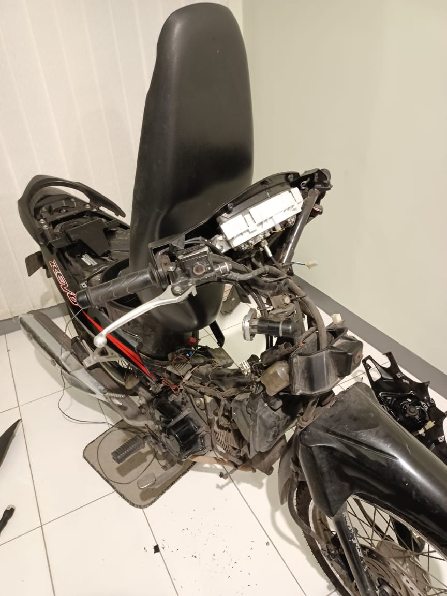

# Project Motor: project documentation

[Back to the README](../README.md)

Supporting project evidence for this snapshot. **Source:** Annexes, section D "Motorcycle Fingerprint Ignition Project" (PDF page 9).

## What the evidence shows

Photographs of the original motorcycle fingerprint prototype. They correspond to the **fingerprint experiment** (`fingerprint_project/`) in this repository.

*Historical motorcycle-mounted fingerprint prototype.*

*Historical motorcycle installation with body panels removed, showing wiring and mounting context.*

## How it relates to this repository

The repository also contains an independent RFID-card experiment. These photos do not show that the two experiments were combined. The code only switches output pins, and the photos show a prototype, not a secure ignition or a safe installation design. The README's security and safety notes still apply.

## Video

### Original video links (currently unavailable)

- [Motorcycle fingerprint ignition video from the annexes](https://drive.google.com/file/d/1lvr0OR0LJZH8E23abRR_TmnrWofCA8/view?usp=sharing). The anonymous request returned HTTP 404 on 22 October 2026; the cause was not established.

## Evidence and rights note

This is supplied portfolio material, not an independent validation. The README's attribution notes (including the Adafruit BSD notice) and publication-rights cautions still apply. No licence or additional permission is implied.
